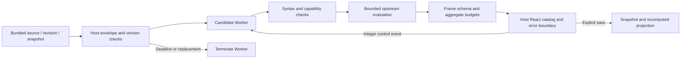

# ADR 0002 · Generated specification admission and runtime safety

**Conditionally accepted direction:** OpenUI Lang is the primary protocol candidate. json-render remains the comparison adapter. **Proposed implementation:** use the pinned language cores to process a restricted profile inside a disposable Worker. **Goal 2 readiness:** ready for a human decision about a profile-limited experiment. Goal 2 is gated on that review. General OpenUI, streaming partial programs, and a production execution service remain outside this decision.

## Threat model

A specification author or snapshot sender controls all source, inputs and claimed outputs. Protect host responsiveness, accepted state, semantic outputs, browser storage and ambient host authority. Treat corpus files like imported source. Trust the browser, bundled dependency versions, admission code, catalog components, preview server headers and local host application. Compromised dependencies, hostile browser extensions, malicious host code, attacks on the operating system and multi-tenant isolation require different controls.

A revision gets its own candidate Worker. The previous admitted frame stays visible during admission. Publication replaces the live session only after successful evaluation and validation. Edits queued against a superseded session cannot publish a stale result. A rejected mutation consumes an update attempt and leaves the committed state intact. A React error unmounts the affected surface and closes its session.

## Pinned upstream investigation

| Question | Public mechanism in 1.2.0 | Limitation and host responsibility |
|---|---|---|
| Parse without execution? | lang-core exports tokenize, split, parseExpression, ASTNode and walkAST. The expression parser builds an AST. | The higher-level parse preprocesses, auto-closes, splits, classifies, and builds a result. split may skip invalid statements; the expression parser tolerates missing tokens. Diagnostics from the streaming renderer alone cannot certify complete source. |
| Inspect references and capabilities? | AST distinguishes component calls, references, state reads, assignments, member/index access and other forms. createLibrary and defineComponent describe a component catalog. | Host checks every declaration, including both conditional branches, rejects unreachable declarations, and restricts identifiers, call sites and arity. A call allowlist and literal contracts are enforced before the evaluator receives a node. |
| Dependencies and cycles? | Ref and StateRef expose dependencies. High-level parse results also report unresolved references and orphaned statements. | Host follows reference edges with an active-path set and charges repeated expansion. Dynamic references, recursively generated component trees and collection iteration are outside the profile. |
| Bound expressions and collection growth? | Public evaluate performs arithmetic and functions such as Sum and Sort. | No public execution-fuel, heap quota or cancellation handle was found in the pinned evaluator. Arithmetic accepts coercion and upstream division by zero yields zero. Host checks numeric operands, finite intermediate results, magnitude, selected-branch divisors and collection types. |
| Interrupt execution? | Upstream expression evaluation is synchronous. | A dedicated Worker performs syntax checks, admission, evaluation and re-evaluation. A host timer calls terminate, rejects outstanding requests and discards that session. The browser test substitutes a finite busy Worker and observes the deadline diagnostic and the Worker close event. |
| Contain errors? | React Renderer supports diagnostics and slots; upstream parse can redact invalid components. | The full upstream React renderer is outside the active path. Host mounts only bounded catalog props. Validation errors reject the operation; a React error boundary contains a trusted rendering failure. |
| Validate state updates? | React useStateField uses store-backed variables; initialState and onStateUpdate expose state. Query and action support also participate in the upstream lifecycle. | Observing a store change is too late for transactional validation. This host derives integer domains from literal Control declarations, validates the full next state, evaluates into a fresh frame and commits on success. |

The reviewed entry points are in the installed lang-core and react-lang packages, particularly parseExpression, split, parse, evaluate, useOpenUIState and RendererRoot. The npm lockfile provides the source tarball identities. Public docs describe the upstream state and error handling conventions. [Reactive state](https://www.openui.com/docs/openui-lang/reactive-state) · [Reliability](https://www.openui.com/docs/openui-lang/reliability)

## Admission policy 1.5.0

- OpenUI accepts a single Stack root listing unique named leaves. The catalog contains Text, Metric, Control, Graphic and Table. One complete declaration occupies one line. Numeric state declarations bind to controls with literal integer bounds and options. Derived expressions admit numeric arithmetic, comparisons, ternaries, bounded literals, named values, Sum and Sort on a numeric score. A strict syntax pass uses Acorn on the shared expression syntax, then the pinned public OpenUI parser supplies the evaluated AST. The Acorn tree is inspected only. Member access, scripts, queries, mutation actions, tool calls and unregistered functions are denied.
- json-render accepts the same catalog in a shallow element graph. Duplicate JSON fields, unreachable elements, aliases/cycles, unknown props and actions are rejected. Allowed dynamic forms are scalar state reads, control bindings and the four registered computations from Goal 1. json-render core resolves admitted properties in the Worker. Default control values for novel JSON revisions are their minima; imported state and the reviewed fixture seeds are explicitly validated.
- Numeric inputs and intermediate numeric results have magnitude at most one billion. Shape props use the original SVG vocabulary. The rendering budget includes group members, rows, values and text. Components receive no source, callbacks from source, markup strings for HTML insertion, host bridge, credentials or tool provider.
- Trusted host settings live in [policy.ts](../../../apps/genui-lab/src/admission/policy.ts). Defaults include 16,000 UTF-8 source bytes, 64,000 envelope bytes, 64 OpenUI declarations, depth 32, 1,500 syntax/expansion nodes, collection length 40, 40 catalog leaves, 120 SVG nodes, 1,500 aggregate value nodes, 10,000 serialized frame bytes, 512 attempted changes per session, eight queued requests and a 2,000 ms deadline per outstanding batch. Protocol schemas have additional narrower caps. Changing a limit requires retesting and policy-version review.
- Restore re-admits the raw specification and validates its input state. The host ignores imported derived values. Provenance records protocol, catalog and policy versions. Legacy Goal 1 manual snapshots pass through the same admission checks. Version fields express compatibility; they provide no sender authentication.

## Evidence and limits

[Reproduction and test artifacts](../../../apps/genui-lab/README.md) cover six reviewed fixtures, three independently authored programs outside the application bundle, malformed input and denied capabilities, updates and rollback, real worker termination, renderer fault recovery, fresh-context restore, forged projections and network denials in page and Worker. A deterministic grammar test checks 100 arithmetic programs and 100 malformed mutations. Model calls during all runs were zero.

The new trust boundary costs a second syntax check, a catalog projection, custom state handling, and a narrower language. That is the tradeoff for keeping generated expressions off the main thread. Reassess the protocol before adding features that would require a general interpreter or unbounded component expansion.

The deadline applies to Worker execution. Main-thread React rendering is bounded structurally and has artifact-level exception handling; an infinite loop in trusted catalog code cannot be interrupted by this design. Browser heap isolation, real-time scheduling guarantees, engine bugs, full upstream grammar equivalence and portability beyond the tested Chromium build remain unverified. Worker network denial depends on the HTTP response policy served by the local production preview. A static host serving only the HTML meta policy needs separate validation. A different deployment or a requirement for hard memory or render-time isolation requires architecture review.
