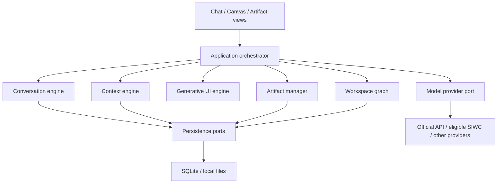

# Architecture baseline v0.2 — proposed

Workspace-centric modular monolith, local-first, provider-independent, ports and adapters. Prefer direct domain calls and streaming events, not microservices or full event sourcing.

Presentation is a projection of domain state. Orchestrator coordinates use cases; engines own business rules. Model provider abstracts listModels, capabilities, streaming generate, usage, errors and cancellation. Preserve capabilities instead of lowest common denominator; report unsupported functionality. Do not assume subscription authorization, memory, history, tools or native GenUI are available via inference API. Verify official eligibility and commercial conditions; BYOK fallback. Credentials in OS secure storage or server-side local process, never browser state.

Deployment proposal: GenUI Lab local Web app (React/TS/Vite); later desktop PoC React Flow, SQLite, Tauri candidate, Electron alternative. Native SwiftUI/AppKit shell with WKWebView is an option if system integration warrants it. Pure Native has potential benefits but greater GenUI ecosystem integration cost. Defer shell decision until benchmark. Use macOS-inspired app chrome and Apps SDK UI for generated content, with consistent tokens. WebKit compatibility and licensing require verification.

Quality drivers: responsiveness, provenance, recoverability, security, portability, extensibility and provider interoperability. Suggested desktop performance targets (unmeasured): 200 summary nodes, 20 visible complex nodes without sustained lag, local interaction <100 ms, focus switch <300 ms, pan/zoom near 60 FPS. Local-first does not imply remote inference keeps data local.

Walking skeleton: create workspace, chat, generate decision UI, branch from answer, promote UI, change state, reference chat/branch/state, synthesize, reopen and restore all. Workstreams GenUI Lab, Context Core, Graph Lab; integrate only after evidence. No graph/vector database, agent framework, cloud sync or collaboration needed initially.
